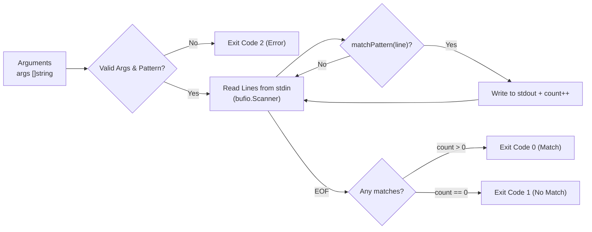

In this assembly capstone, you assemble your Stage 1 pattern matching engine into your first working command-line tool.

## Code Self-Review: Token Parsing & Rune Boundaries

The starter template includes canonical reference implementations of all pattern-matching components built throughout Stage 1 (`parsePattern`, `matchToken`, `matchHere`, `matchPattern` supporting character classes `\d`, `\w`, character sets `[...]`, `[^...]`, ranges `[a-z]`, anchors `^` and `$`, repetition `+`, `?`, and wildcard `.`).

> [!NOTE]
> Before implementing the CLI pipeline, review the pre-populated reference matcher in the editor:
> - **Rune vs. Byte Slicing**: How does `matchHere` handle character boundaries when evaluating multibyte Unicode runes?
> - **Anchor Strictness**: Notice how `anchoredStart` and `anchoredEnd` constrain the search window. Compare this with how your initial solutions handled empty strings.

---

## Assembly Architecture: Standard I/O Pipeline

A standard Unix filter reads input lines, evaluates them against a compiled pattern, prints matching lines to standard output, and exits with a deterministic status code:



### Exit Codes Contract
Like standard `grep`, `gorp` uses exit status codes to report execution outcomes:
- **`0`**: Pattern matched at least one input line.
- **`1`**: No input lines matched the pattern.
- **`2`**: An error occurred (e.g., missing pattern argument, empty pattern, or I/O error).

---

## Task

Implement `RunCLI`:

```go
func RunCLI(stdin io.Reader, stdout io.Writer, args []string) int
```

- If `len(args) == 0` or `args[0] == ""`, return exit code `2`.
- Read lines from `stdin` using `bufio.NewScanner`.
- If a line matches the pattern `args[0]`, write the line followed by `\n` to `stdout`.
- Return `0` if at least one line matched, `1` if zero lines matched, or `2` if scanner encountered an error.

---

## Running Locally

In your local `gorp` workspace, copy your assembly solution into `cmd/gorp/main.go` and `pkg/matcher/`:

```bash
# 1. Compile your binary
go build -o bin/gorp ./cmd/gorp

# 2. Test standard input piping
echo -e "apple\nbanana\napricot" | ./bin/gorp "^ap"

# 3. Verify exit codes
echo "hello" | ./bin/gorp "world"; echo "Exit: $?"
# Output: Exit: 1
```
