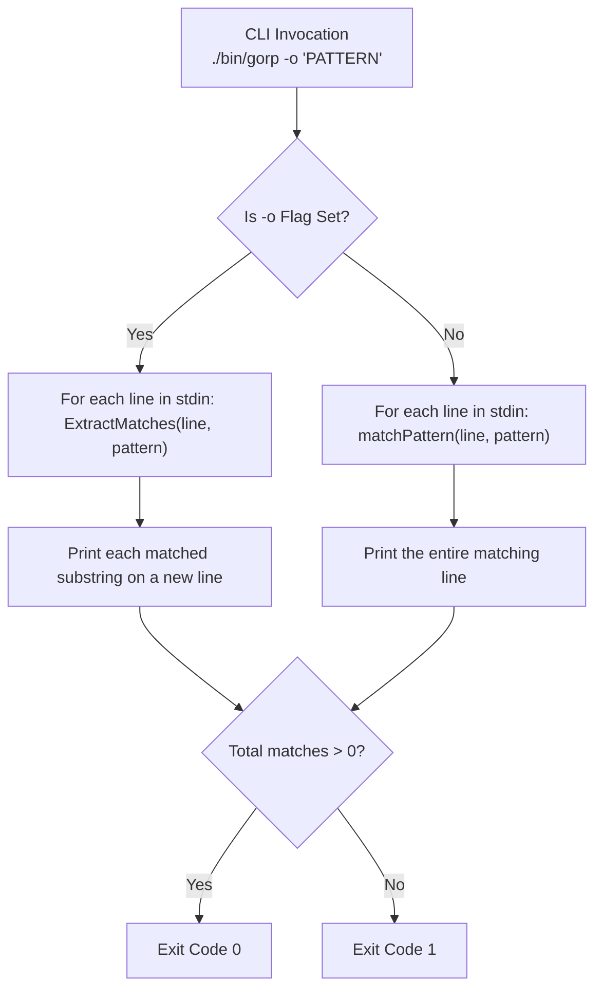

In this assembly capstone, you extend your command-line matcher to support match-only extraction (`-o` / `--only-matching`), capture groups, and backreferences.

## Code Self-Review: Backtracking State & Capture Storage

The starter template includes canonical reference implementations of all Stage 2 components:
- Bounded quantifiers (`*`, `{n}`, `{n,}`, `{n,m}`)
- Alternation (`cat|dog`)
- Nested capture groups (`(...)`) and backreferences (`\1`, `\2`)
- Substring match extractor (`ExtractMatches`)

> [!NOTE]
> Before implementing the `-o` CLI flag, inspect the pre-populated matcher in the editor:
> - **Capture Table Restoration**: When a speculative branch fails inside `matchAt`, note how `ctx.captured[tok.groupId]` is restored to its previous value rather than deleted. What subtle corruption occurs if prior capture states are overwritten without restoration during backtracks?
> - **Non-Overlapping Match Windows**: Notice how `ExtractMatches` advances `i = end` upon finding a match rather than `i++`. Why is this required to prevent infinite loops when a pattern matches zero runes?

---

## Assembly Architecture: The `-o` / `--only-matching` Pipeline

In standard `grep`, the `-o` option instructs the tool to print only the matched non-empty parts of matching lines, with each such part on a separate output line.



---

## Task

Implement `RunCLI`:

```go
func RunCLI(stdin io.Reader, stdout io.Writer, args []string) int
```

- Parse command-line arguments:
  - Support `-o` and `--only-matching` flags.
  - The pattern can be specified before or after flags (e.g., `["-o", "\\w+"]` or `["\\w+", "-o"]`).
  - If no pattern is provided, return exit code `2`.
- When `-o` is enabled:
  - For each line read from `stdin`, call `ExtractMatches(line, pattern)`.
  - For each extracted match, print it to `stdout` followed by `\n`.
- When `-o` is not enabled:
  - Print the entire matching line followed by `\n`.
- Return `0` if at least one match was found and output, `1` if no matches were found, and `2` on error.

---

## Running Locally

In your local `gorp` workspace, copy your assembly solution into `cmd/gorp/main.go` and `pkg/matcher/`:

```bash
# 1. Compile the binary
go build -o bin/gorp ./cmd/gorp

# 2. Extract only email addresses from realistic dataset
./bin/gorp -o "\w+@\w+\.com" testdata/emails.txt

# 3. Test backreferences locally
./bin/gorp "([a-zA-Z]+) \1" testdata/sample.txt
```
