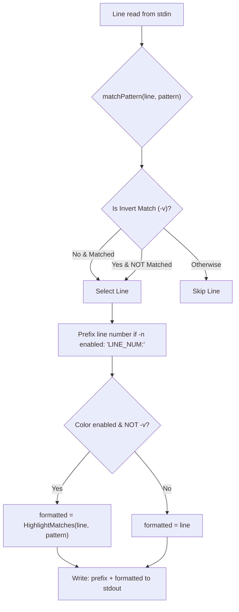

In this assembly capstone, you assemble your ANSI color highlighter, TTY auto-detection, and standard terminal formatting options (`-n`, `-v`, `--color`).

## Code Self-Review: ANSI Escapes & Terminal Detection

The starter template includes canonical reference implementations of all Stage 3 formatting components:
- `HighlightMatches`: Slices non-overlapping match intervals and wraps them in ANSI escape codes (`ColorRed` and `ColorReset`).
- `ParseColorOption` & `ShouldColor`: Resolves whether colorization should be activated based on CLI configuration, standard output TTY status, and the `NO_COLOR` environment specification.

> [!NOTE]
> Before implementing the CLI pipeline, review the pre-populated highlighter in the editor:
> - **Inverted Match Safety**: When `-v` (invert match) is selected, why should matched ANSI escape codes *not* be injected into the output line?
> - **TTY Auto-Detection**: Notice why `--color=auto` must disable ANSI codes when piping to another program (`|`) or writing to a file, preventing terminal escape sequences from corrupting text streams.

---

## Assembly Architecture: Unified Terminal Formatting

The formatting pipeline combines line numbers, inverted selection, and color highlights into a clean output:



---

## Task

Implement `RunCLI`:

```go
func RunCLI(stdin io.Reader, stdout io.Writer, args []string, isTTY bool, noColorSet bool) int
```

- Parse CLI flags from `args`:
  - `-n`, `--line-number`: Prefix each output line with its 1-based line number (`1:line`).
  - `-v`, `--invert-match`: Invert match logic to print non-matching lines.
  - `--color=[always|never|auto]` (default: `auto`).
  - Remaining argument is the regex `pattern`. Return `2` if missing.
- Resolve whether color highlighting is enabled:
  - If `colorOpt == "always"`: `true`
  - If `colorOpt == "never"`: `false`
  - If `colorOpt == "auto"`: `isTTY && !noColorSet`
- For each line read from `stdin`:
  - When `-v` is false: line is selected if it matches `pattern`. If color is enabled, highlight matches with `HighlightMatches(line, pattern)`.
  - When `-v` is true: line is selected if it does *not* match `pattern`. Never highlight inverted matches.
  - If selected, print `[linenumber:]<line>\n` to `stdout`.
- Return `0` if at least one line was emitted, `1` if zero lines were emitted, and `2` on error.

---

## Running Locally

In your local `gorp` workspace, copy your assembly solution into `cmd/gorp/main.go` and `pkg/display/`:

```bash
# 1. Compile the binary
go build -o bin/gorp ./cmd/gorp

# 2. Test colorized matches on realistic server logs with line numbers
./bin/gorp --color=always -n "ERROR" testdata/server.log

# 3. Test inverted matching (lines without errors)
./bin/gorp -v "ERROR" testdata/server.log
```
