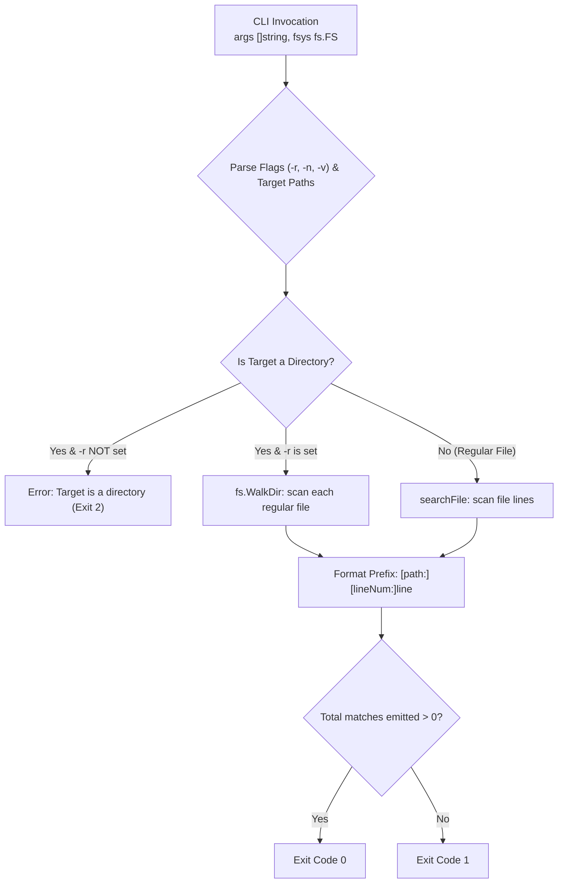

In this assembly capstone, you assemble multi-file search and recursive directory traversal into a complete filesystem grep tool.

## Code Self-Review: File Descriptors & Directory Traversal

The starter template includes canonical reference implementations of the Stage 4 filesystem scanning engine:
- `searchReader`: Streaming line scanner on `io.Reader`.
- `searchFile`: Safe file opener and scanner using `defer file.Close()`.
- `searchDirectory`: Recursive directory tree traversal using `fs.WalkDir`.

> [!NOTE]
> Before implementing the filesystem CLI, inspect the reference implementation in the editor:
> - **File Descriptor Leaks**: When walking deep directory trees with hundreds of files, why is immediate cleanup via `defer file.Close()` inside the file processing function boundary essential?
> - **Path Prefixes**: Why does standard grep include `<filename>:` prefixes only when searching multiple files or using recursive traversal (`-r`), but omit them when searching a single specific file?

---

## Assembly Architecture: Filesystem Traversal Pipeline



---

## Task

Implement `RunCLI`:

```go
func RunCLI(fsys fs.FS, stdout io.Writer, args []string) int
```

- Parse flags and arguments:
  - `-r`, `-R`, `--recursive`: Recursively search directories.
  - `-n`, `--line-number`: Prefix matches with 1-based line numbers.
  - `-v`, `--invert-match`: Invert match logic to select non-matching lines.
  - First non-flag argument is `pattern`.
  - Subsequent non-flag arguments are target `paths`. (If missing, return `2`).
- Target evaluation:
  - If a target is a directory and recursive search (`-r`) is not set, report error and return exit code `2`.
  - If multiple target files are passed OR recursive search (`-r`) is enabled, include the file path prefix `<path>:`.
  - If `-n` is set, include `<lineNum>:`.
  - Format: `[<path>:][<lineNum>:]<line>\n`
- Return `0` if matches were found and printed, `1` if no matches were found, and `2` on any error (file not found, missing pattern, etc.).

---

## Running Locally

In your local `gorp` workspace, copy your assembly solution into `cmd/gorp/main.go` and `pkg/search/`:

```bash
# 1. Compile the binary
go build -o bin/gorp ./cmd/gorp

# 2. Search recursively across the sample codebase
./bin/gorp -rn "func " testdata/codebase

# 3. Search multiple specific files
./bin/gorp -n "INFO" testdata/server.log testdata/sample.txt
```
